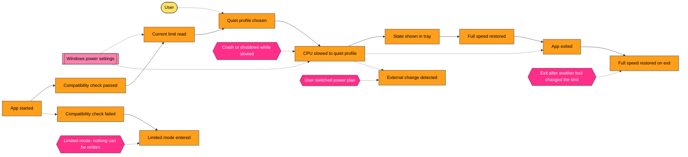

# ThermoWhisper - Event Storming Big Picture (short mode, drafted by the analyst from the PO answers, 2026-10-22)

Legend: orange = domain event, yellow = actor, pink = external system, neon pink = hotspot (colors from the team template).

## 1. Chaotic exploration (events)
- PO (from answers): CPU slowed to the quiet profile; full speed restored; app exited and full speed restored; real state shown; quiet profile changed; autostart enabled or disabled; donation reminder shown.
- Analyst: App started; Compatibility check passed / failed; Limited mode entered; Settings opened / closed; Current limit read; External change detected (another tool changed the limit); Language changed; Power write rejected.
- Tech-lead: Power write failed (policy, error code); State refreshed (menu open, 3-min timer, after write).

## 2. Timeline

Side flows (rows): Autostart enabled / disabled (Windows startup task; may be disabled by user or policy); Donation reminder shown (once, 7 days after first run); Language changed.

## 3. Pivotal events
- Compatibility check passed / failed (normal vs limited mode).
- CPU slowed to quiet profile / Full speed restored (the core state change).
- App exited (ends in full speed when writing is possible).

## 4. Actors and external systems
- Actor: User (laptop owner).
- Systems: Windows power settings (powrprof API, powercfg fallback) - source of truth for the limit; Windows startup task (autostart); Windows notifications (donation toast); Windows tray (H.NotifyIcon); local app data (MAUI Preferences / SecureStorage: quiet profile, language, first-run date, donation flag).

## 5. Hotspots
1. Exit while another tool changed the limit: Exit sets 100 % regardless. Accepted by the PO (Q7); confirm in a test.
2. Windows crash, app kill or shutdown while slowed: Exit never runs, the CPU stays slowed (the system keeps the value). Not solved in v1.0; the user clicks Restore Speed. ASSUMPTION: acceptable.
3. User switches power plan: the limit belongs to the active plan; the new plan may be at 100 %. We only show the real state (Q8), never fight back. Slow Down changes the active plan only.
4. Limited mode (check failed, no writes): Exit must not try to restore.
5. App started while the CPU is already limited (earlier crash, or another tool): show the real state; the slowed icon is shown whenever the real limit is below 100 %.
6. Quiet profile changed while slowed: does Apply re-slow at the new % at once? ASSUMPTION: yes if currently slowed, otherwise it only saves the choice (confirmed: `ChangeQuietProfile`).
7. Refresh timing: state is read when the tray menu opens and every 3 min while Settings is visible; between reads the tooltip may be stale.

## 6. Value and opportunities
- Value: one click gives silence (night, overnight heavy tasks, recording with a sensitive microphone).
- Pain: "maximum processor state" is hidden deep in Windows; forgetting to restore leaves the laptop slow.
- Opportunity (not v1.0): presets, schedules, auto-switch by battery or app.

## 7. Emerging contexts
- Power control: CPU slowed to quiet profile, Full speed restored, Current limit read, External change detected, Compatibility check passed / failed, Limited mode entered.
- Tray app: App started, App exited, State shown in tray, Settings opened / closed, Quiet profile chosen, Language changed, Autostart enabled / disabled.
- Donation reminder: First run recorded, Donation reminder shown (small and separate from power control).
- Code boundaries: Power control = Domain + Application power use cases + Infrastructure `Power/`, `Compatibility/`; Tray app = App project (tray, Settings, autostart, localization); Donation reminder = Application donation schedule + App `Notifications/` + SecureStorage. Links: Tray app -> Power control only through use cases; Donation reminder independent.

Software Design: not needed (small domain, one aggregate-like rule set).
